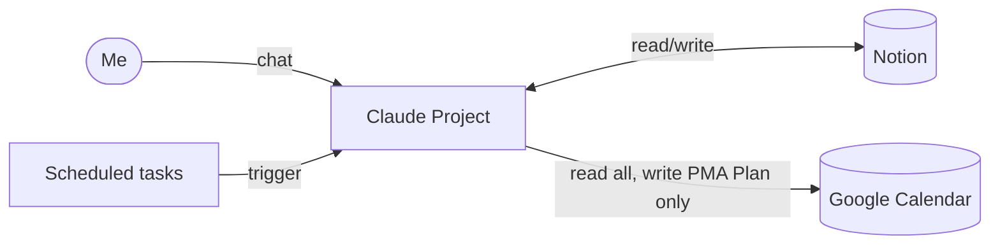

# Product Requirements Document — Personal Project Manager Agent (PMA)

**Version:** 1.2 · **Updated:** 12 Nov 2026 · **Owner:** individual user (me)
**Platforms:** Claude (Project + scheduled tasks), Notion, Google Calendar
**Approach:** no-code; connectors only

---

## 1. Overview

The PMA is a Claude Project that reads my Notion Master Project Tracker and Google Calendar, tells me what to work on each day, plans work blocks into a dedicated calendar, and replans when work overruns — only after I approve.

**Vision:** one assistant that brings my projects, deadlines and calendar together and gives clear, realistic recommendations, so I don't have to review everything myself.

**Problems it solves:** poor prioritisation across many projects; forgotten projects; uneven progress; turning free time into a realistic plan; overwhelm; lack of accountability.

### Success criteria
- All active projects visible in one Notion database.
- "What should I work on today?" returns a prioritised, explained answer.
- Recommendations respect deadlines and calendar availability.
- New projects can be captured in conversation.
- Neglected projects are flagged.
- A daily brief and reminders arrive without my prompting.
- Calendar changes happen only after my approval, and never to fixed commitments.

### What changed from v1.0

| Area | v1.0 (ChatGPT) | v1.2 (Claude) |
|---|---|---|
| AI brain | ChatGPT | Claude Project with custom instructions |
| Notion access | Notion app in ChatGPT | Notion connector |
| Calendar | iCloud Calendar app | Google Calendar connector; agent writes only to **PMA Plan** |
| Rules | In the chat prompt | Notion **PMA Operating Manual**, read on every run |
| Priority Score | Set by the AI | Notion formula + Scoring Rules page the agent calculates from |
| Reminders | ChatGPT Automations | 3 Claude scheduled tasks |
| Daily plan | Suggested in chat | **This Week** section in Notion + PMA Plan calendar blocks |
| Replanning | Not covered | Evening check-in, urgent task, calendar check |

---

## 2. Architecture

- **Claude Project "Personal Project Manager"** — the agent. Short custom instructions; full rules fetched from Notion at the start of every chat.
- **Notion** — Master Project Tracker (database), This Week, Scoring Rules, PMA Operating Manual (incl. Estimation Log and Change Log), Draft Plan pages.
- **Google Calendar** — fixed calendars (University Schedule, Part time Job) and plan-around calendars (TO DOs, Social, Trips and Holiday) are read-only. **PMA Plan** holds all agent-scheduled work blocks.
- **Scheduled tasks** — run in fresh sessions; self-contained prompts; read the manual from Notion.

---

## 3. Notion data model

Master Project Tracker properties — see [`../notion/database-schema.md`](../notion/database-schema.md).

**Priority Score** (20–100; Completed = 0):

`Score = round((0.30·Urgency + 0.25·Importance + 0.20·Strategic value + 0.15·Progress risk + 0.10·Neglect) × 20)`

Component bands are in [`scoring-rules.md`](scoring-rules.md). The Notion connector cannot return formula results, so the agent always recalculates from raw properties.

**This Week** — weekly goals and one checklist per day (`task · project · estimate`), rewritten each week on approval.

---

## 4. Calendar rules

| Action | Permission |
|---|---|
| Read all calendars, find free time | Allowed |
| Suggest blocks or a schedule | Allowed |
| Create / move / delete blocks in **PMA Plan** | Only after I approve the specific list of changes |
| Any change to University Schedule, Part time Job or other calendars | Never |
| Scheduled (unattended) runs | Read-only |

Blocks are titled `[PMA] <Project> – <task>`. Overlaps between my own events on other calendars are deliberate and not flagged.

---

## 5. Planning rules

- Working window **[WORKING HOURS]**; nothing scheduled after [SUNDAY CUT-OFF] on Sundays.
- Daily lunch block [LUNCH TIME]; moves to the next free afternoon slot if a lecture clashes; none on [LONG SHIFT HOURS] work shift days.
- Sunday [SUNDAY REVIEW SLOT] weekly review block.
- Focused work: ≤ ~5 h on lecture/shift days, ≤ ~7 h on free days. Never over a shift.
- Blocks of 60–120 min, 15-min breaks, 15 min clear of fixed events, travel time before campus lectures.
- Priority order: university deadlines within 14 days → other dated deadlines → highest Priority Score → undated projects fill gaps (none untouched > 7 days).
- Finish deadline work 2 days early; larger mark weight first when deadlines coincide.
- Estimates: Estimated Hours × (1 − Progress); +20% for unfamiliar tasks; scaled using the Estimation Log.
- If it doesn't fit, say what doesn't and ask what to drop.

---

## 6. Features

| # | Feature | Priority | Trigger | What it does |
|---|---|---|---|---|
| 1 | Prioritisation | P0 | "What's most urgent?" | Ranks projects by calculated Priority Score, one-line reason each |
| 2 | Morning brief | P0 | [MORNING BRIEF TIME] scheduled task / "briefing" | Today's commitments and blocks, to-dos, weekly goals, watch list |
| 3 | Weekly plan | P0 | "plan my week" | Goals → daily tasks → blocks in free time → approve → PMA Plan + This Week |
| 4 | Evening check-in | P0 | Evening reminder / "evening update: …" | Updates progress and Estimation Log, proposes replan |
| 5 | Urgent task | P1 | "urgent: …" | Fits urgent work by pushing lower-priority blocks |
| 6 | Project capture | P1 | Mention a new idea | ≤ 2 questions, proposes properties, adds after confirmation |
| 7 | Weekly review | P1 | Sunday [SUNDAY REVIEW TIME] task / "weekly review" | Review + Draft Plan page in Notion |
| 8 | Approve draft plan | P1 | "approve draft plan" | Re-checks draft against calendar, applies after OK |
| 9 | Calendar check | P1 | "check my calendar" | Moves clashing PMA blocks around new events after OK |

### Morning brief format
1. Today — fixed commitments and PMA blocks in time order
2. Today's tasks — from This Week, with estimates and why each matters
3. Weekly goals — on track / at risk
4. Watch — deadlines within 7 days, projects untouched 7+ days
5. Don't forget — admin and follow-ups

### Weekly review format
Progress · outstanding work · estimate accuracy · three reflection questions (what went well, what didn't get done, what should change) · priority changes.

---

## 7. Non-functional requirements
- **Simplicity:** no technical knowledge needed day to day.
- **Reliability:** data comes live from Notion and Google Calendar on every run.
- **Transparency:** every priority is explained.
- **User control:** no calendar or plan change without approval.
- **Maintainability:** rules changed in one place (Notion manual), with a change log.
- **Realism:** respects working hours, lectures, shifts and rest.
- **Integrity:** respects each assessment's AI-use rules; plans and tracks assessed work but never writes it.
- **Privacy:** data accessed only through authorised connectors.

---

## 8. Known limitations

| Limitation | Workaround |
|---|---|
| Notion connector can't read formula results | Agent calculates from the Scoring Rules page |
| Scheduled runs can't ask for approval | Read-only; Sunday task writes a Draft Plan page for later approval |
| Runs don't remember each other | All state lives in Notion (progress, This Week, Estimation Log) |
| New projects with no Last Worked On score as fully neglected | Log work as it happens |
| No separate task database | Next Action + checklists in project pages |

---

## 9. Roadmap
- **v2.0** — linked Tasks database, dependency tracking, workload-conflict detection, smarter scoring.
- **v3.0** — Python prioritisation engine, API integrations, productivity analytics dashboard.
- **v4.0** — portfolio case study: AI integration, workflow automation, product management, agentic design.

---

## 10. Change log
See [`../CHANGELOG.md`](../CHANGELOG.md).
